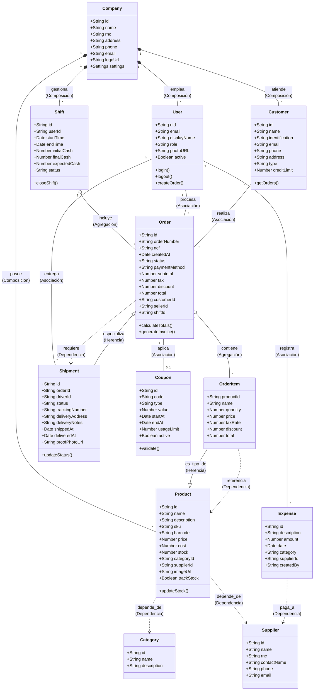

# DOCUMENTACIÓN TÉCNICA - ZENDA ERP

**Cliente:** Batey Creativo SRL  
**Fecha:** 25 de Noviembre de 2025  
**Versión:** 1.0

---

## CAPÍTULO 1: CONTEXTUALIZACIÓN DEL PROYECTO

### 1.1 Contextualización

#### Problemática

Actualmente, **Batey Creativo SRL** enfrenta desafíos significativos en la gestión operativa de sus ventas e inventarios. El proceso manual o fragmentado de facturación genera lentitud en la atención al cliente, errores humanos en los cálculos de impuestos y descuentos, y una falta de visibilidad en tiempo real sobre el stock de productos. Además, el control de los envíos y la logística de entrega se maneja de manera informal, lo que ocasiona incertidumbre sobre el estado de los paquetes y dificultades para cuadrar las cajas al final de los turnos de los empleados.

#### Importancia

La implementación de un sistema automatizado es crucial para modernizar la infraestructura operativa de la empresa. Permitirá centralizar la información, asegurar la integridad de los datos financieros y optimizar el flujo de trabajo desde la toma del pedido hasta la entrega final al cliente.

#### Necesidad del Cliente

**Batey Creativo SRL** requiere una solución tecnológica integral que sea accesible tanto desde computadoras de escritorio (para cajeros y administradores) como desde dispositivos móviles (para repartidores). Necesitan un sistema que soporte facturación rápida, gestión de inventario, control de gastos, múltiples roles de usuario y seguimiento de envíos mediante tecnología QR.

#### Justificación

El desarrollo de "Zenda ERP" se justifica por la necesidad de reducir los tiempos operativos y minimizar las pérdidas por errores administrativos. Al digitalizar el negocio, Batey Creativo SRL podrá tomar decisiones basadas en datos reales, mejorar la satisfacción del cliente mediante procesos más rápidos y asegurar el control financiero mediante cierres de caja automatizados y auditoría de acciones.

#### Limitantes y Alcances

**Alcances:**

- **Gestión de Ventas:** Facturación POS, cotizaciones, pedidos y notas de crédito/débito.
- **Inventario:** Control de stock, variantes de productos, categorías y alertas de bajo stock.
- **Usuarios y Seguridad:** Sistema de roles (Administrador, Gerente, Vendedor, Repartidor) con permisos granulares.
- **Logística:** Módulo de envíos con cambios de estado (Enviado/Entregado) y validación.
- **Marketing:** Sistema de cupones y ofertas con validaciones complejas.
- **Plataforma:** Aplicación Web y Desktop (Electron).

**Limitantes:**

- El sistema requiere conexión a internet para la sincronización en tiempo real (aunque cuenta con una cola offline limitada).
- La capacidad de almacenamiento de imágenes y documentos está sujeta a las cuotas del servicio de nube (Firebase).
- No incluye integración directa con sistemas bancarios locales (pagos con tarjeta se registran manualmente o vía pasarela externa simple).

### 1.2 Propuesta de Proyecto (OBJETIVO GENERAL)

Desarrollar e implementar "Zenda ERP", una plataforma de gestión empresarial multiplataforma para **Batey Creativo SRL**, que automatice los procesos de facturación, control de inventario y logística de envíos, utilizando tecnologías web modernas y servicios en la nube para garantizar la escalabilidad, seguridad y disponibilidad de la información en tiempo real.

### 1.3 Objetivos Específicos

1. **Analizar** los flujos de trabajo actuales de Batey Creativo SRL para identificar los puntos críticos en la facturación y despacho de mercancía.
2. **Diseñar** una arquitectura de software escalable y una interfaz de usuario intuitiva que facilite la adopción del sistema por parte del personal operativo.
3. **Desarrollar** los módulos funcionales de inventario, facturación, gestión de usuarios y seguimiento logístico utilizando React y Firebase.
4. **Implementar** mecanismos de seguridad y validación de datos, incluyendo roles de usuario y confirmación de entregas, para asegurar la integridad de la información.

---

## CAPÍTULO 2: METODOLOGÍA Y TECNOLOGÍA

### 2.1 Metodología de Trabajo

Para la realización de este proyecto se utiliza la metodología ágil **Scrum**.

- **Sprints:** Ciclos de desarrollo iterativos donde se implementan funcionalidades específicas (ej. "Módulo de Cupones", "Confirmación QR").
- **Reuniones:** Dailies para sincronización y Retrospectivas para mejora continua.
- **Entregables:** Versiones incrementales del software funcional desplegadas para pruebas del cliente.

### 2.2 Ambientes de Trabajo

#### Lenguajes de Programación y Tecnologías

- **Frontend:** JavaScript (ES6+), React.js (Vite).
- **Estilos:** Tailwind CSS.
- **Desktop Wrapper:** Electron.js.
- **Backend (Serverless):** Node.js (Google Cloud Functions).

#### Gestor de Base de Datos

- **Base de Datos:** Google Firebase Firestore (NoSQL).
- **Almacenamiento de Archivos:** Firebase Storage.
- **Autenticación:** Firebase Authentication.

#### APIs y Librerías Principales

- **Firebase SDK:** Para conexión a base de datos y auth.
- **React Router:** Navegación SPA.
- **Recharts:** Visualización de datos y reportes.
- **Lucide React:** Iconografía.
- **React Hot Toast:** Notificaciones al usuario.

### 2.3 Diagrama de Clases (UML)



### 2.4 Análisis y Diagrama de Casos de Uso

#### Actores Principales

1. **Administrador:** Acceso total al sistema, configuración y reportes financieros.
2. **Vendedor:** Realiza ventas, crea pedidos, aplica cupones y registra clientes.
3. **Repartidor (Driver):** Visualiza envíos asignados y marca pedidos como entregados.
4. **Gerente:** Supervisa operaciones, anula facturas y gestiona inventario.

#### Diagrama de Casos de Uso

```mermaid
useCaseDiagram
    actor "Administrador" as Admin
    actor "Vendedor" as Seller
    actor "Repartidor" as Driver

    package "Sistema Zenda ERP" {
        useCase "Gestionar Usuarios" as UC1
        useCase "Ver Reportes Financieros" as UC2
        useCase "Crear Factura/Pedido" as UC3
        useCase "Aplicar Cupón" as UC4
        useCase "Gestionar Inventario" as UC5
        useCase "Marcar Envío como Entregado" as UC6
        useCase "Cierre de Caja" as UC7
    }

    Admin --> UC1
    Admin --> UC2
    Admin --> UC5
    Admin --> UC7
    
    Seller --> UC3
    Seller --> UC4
    Seller --> UC7

    Driver --> UC6
```

### 2.5 Diagrama de Infraestructura (Despliegue)

```mermaid
graph TD
    subgraph "Cliente (Batey Creativo SRL)"
        PC[PC Escritorio (Electron/Web)]
        Mobile[Dispositivo Móvil (Web)]
    end

    subgraph "Internet"
        Cloud[Nube / Internet]
    end

    subgraph "Google Firebase Platform"
        Auth[Firebase Authentication]
        Hosting[Firebase Hosting]
        DB[(Firestore Database)]
        Func[Cloud Functions]
        Storage[Cloud Storage]
    end

    PC -->|HTTPS| Hosting
    Mobile -->|HTTPS| Hosting
    PC -->|WebSocket/HTTPS| DB
    Mobile -->|WebSocket/HTTPS| DB
    PC -->|API Call| Func
    PC -->|Auth Token| Auth
    PC -->|Upload/Download| Storage
```

---

## CAPÍTULO 3: ANÁLISIS ESTRATÉGICO

### 3.1 Análisis FODA

#### Fortalezas

- **Sincronización en Tiempo Real:** Todos los dispositivos ven la misma información al instante.
- **Multiplataforma:** Funciona en web y como aplicación de escritorio instalable.
- **Interfaz Moderna:** UX/UI intuitiva diseñada con React y Tailwind.
- **Flexibilidad:** Sistema de roles y permisos adaptable.

#### Oportunidades

- **Expansión Móvil:** Desarrollo de una App nativa (React Native) para repartidores.
- **Integración IA:** Predicción de stock y análisis de ventas inteligente.
- **E-commerce:** Integrar una tienda pública conectada al mismo inventario.

#### Debilidades

- **Dependencia de Conectividad:** Aunque tiene modo offline parcial, requiere internet para funcionalidad completa.
- **Curva de Aprendizaje:** El personal acostumbrado a papel debe adaptarse al flujo digital.

#### Amenazas

- **Fallas de Internet:** Interrupciones prolongadas en el servicio de internet del local.
- **Cambios en Plataforma:** Cambios en los precios o políticas de uso de Firebase.

### Matriz FODA (Estrategias)

| | **Fortalezas** | **Debilidades** |
| :--- | :--- | :--- |
| **Oportunidades** | **Estrategia FO (Ofensiva):** Utilizar la sincronización en tiempo real para ofrecer una App Móvil a los repartidores que actualice el estado al instante. | **Estrategia DO (Reorientación):** Desarrollar un modo offline más robusto (PWA) para mitigar la dependencia de conectividad antes de expandirse a zonas con mala cobertura. |
| **Amenazas** | **Estrategia FA (Defensiva):** Aprovechar la arquitectura flexible para crear respaldos locales o híbridos en caso de cambios en la plataforma nube. | **Estrategia DA (Supervivencia):** Capacitar intensivamente al personal (reduciendo la curva de aprendizaje) para que sepan operar el sistema eficientemente y minimizar el impacto de fallas operativas. |

### 3.2 Análisis Costo-Beneficio y Riesgo

#### Análisis Costo-Beneficio

- **Costos:**
  - Desarrollo de software (Horas hombre).
  - Costos operativos de Firebase (Modelo "Pay as you go", bajo costo inicial).
  - Hardware (Computadoras e impresoras térmicas ya existentes o de baja inversión).
- **Beneficios:**
  - **Reducción de Mermas:** Control estricto de inventario reduce robos y pérdidas.
  - **Ahorro de Tiempo:** Facturación en segundos vs minutos manuales.
  - **Toma de Decisiones:** Reportes instantáneos permiten ajustar estrategias de venta rápidamente.
  - **Imagen Corporativa:** Profesionalización de facturas y seguimiento de envíos.

**Conclusión:** El retorno de inversión (ROI) se estima positivo a corto plazo debido a la reducción de pérdidas de inventario y el aumento en la velocidad de procesamiento de ventas.

#### Análisis de Riesgos

| Riesgo | Probabilidad | Impacto | Mitigación |
| :--- | :--- | :--- | :--- |
| **Pérdida de Datos** | Baja | Alto | Backups automáticos diarios en Firestore y reglas de seguridad estrictas. |
| **Caída del Servicio de Internet** | Media | Medio | Implementación de cola de peticiones offline (Offline Queue) para guardar ventas localmente y sincronizar al reconectar. |
| **Acceso No Autorizado** | Baja | Alto | Autenticación robusta, reglas de seguridad en base de datos y expiración de sesiones. |
| **Bugs Críticos en Producción** | Media | Alto | Ambiente de pruebas (Staging), CI/CD y monitoreo de errores en tiempo real. |
